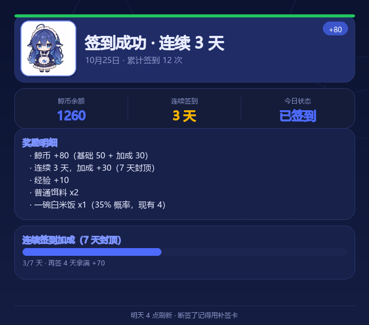
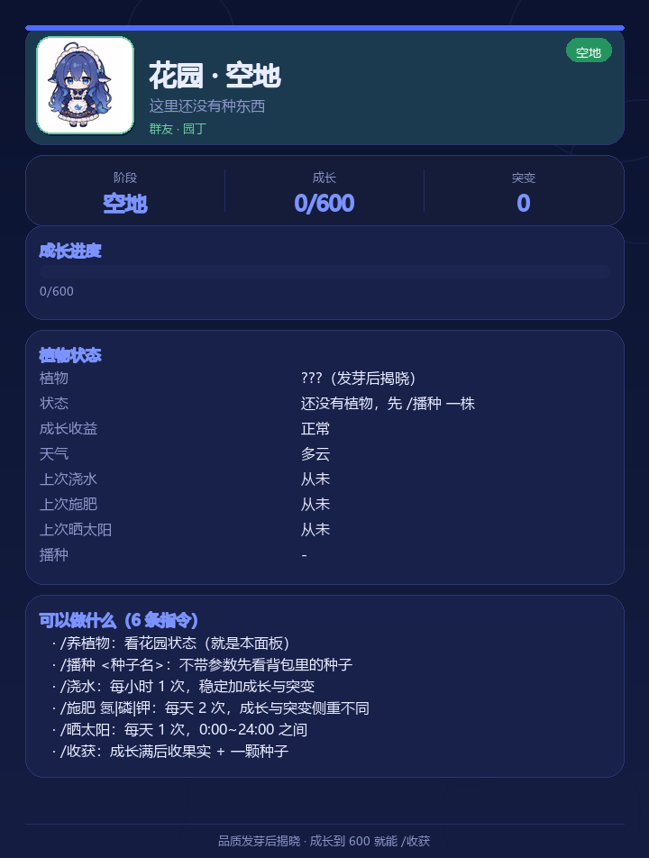

# 赛博鲸鱼馆 · 钓鱼与后宫（AstrBot 插件）

> 群共享池塘钓鱼 / 签到喂食打工 / 娶群友与后宫 / 全套指令 Pillow 出图
> **为 2 核 2G 服务器设计**：全异步、零轮询、连接池封顶 5 条、出图缓存三重限流。

   

---





## 1. 它是什么

一个纯本地、无外部依赖（除 aiosqlite / Pillow）的 QQ 群玩法插件：

- **池塘是群共享的**：等级、材料、贡献度全群共用；升级材料只能钓鱼掉，商店买不到。
- **钓鱼是核心**：必须消耗饵料；抛竿后等 5~60 分钟（受天气修正），**到点后本人再发一条消息才提杆**，
  上钩率 = 基础 + 池塘等级 + 体验券 + 饵料品质 + 天气，材料必出。
- **随机天气**：晴/多云/小雨/雷雨/大雾/流星雨/寒潮，每 6 小时一变，同时影响等待时长、上钩率、
  物品品质、鱼星、鲸币与材料；每种天气都有 1 个增益 + 1 个负面，可用「天气控制机」锁定 3 天。
- **钓鱼与打工互不阻塞**：可以一边等鱼一边上班；**喂食喂的是鲸鱼娘 bot**，与娶群友系统互不影响。
- **私聊也能用**：签到/喂食/钓鱼/打工/仓库/商店等日常指令支持私聊（池塘用 private:<uid> 独立作用域）。
- **花园（养植物）**：S~E 种子、7 档植物品质、6 个成长阶段；浇水/施肥/晒太阳/播种，
  突变值决定收获种子的档位，果实能做「果实餐」喂鲸鱼娘，全部绿色面板。
- **社交是消耗口**：娶群友（10% 起、5 次保底）、离婚（50%、2 次必中）、NTR（5% 起、10 次保底）、后宫与恩爱榜。
- **每条指令都回一张图**：Pillow 排版 + **DeepSeek 蓝鲸鱼娘**形象（Q 版/2D，来自社区形象），带缓存与 OOM 防护。

## 2. 仓库结构

```
astrbot_plugin_whale_harem/
├── main.py               # 插件入口：22 条指令 + 群消息监听（提杆/收工）
├── metadata.yaml         # AstrBot 插件元信息
├── _conf_schema.json     # WebUI 配置项
├── requirements.txt      # aiosqlite / Pillow
├── assets/               # DeepSeek 鲸鱼娘形象（Q 版 + 2D 立绘）
├── core/                 # 常量、配置、DB 池、随机、天气、异步工具
├── data/                 # 物品表、鱼表、掉落池、植物图鉴与花园物品（纯数据）
├── services/             # 签到/喂食/打工/钓鱼/池塘/婚姻/商店/道具/仓库/花园
├── ui/                   # Pillow 渲染器、主题、缓存、形象贴纸、花园绿色面板
├── sql/schema.sql        # 数据库 DDL（可读版）
├── scripts/              # 测试 / 出图 / 数值模拟（开发用，不影响运行）
├── docs/                 # 架构、数值、防崩溃、测试报告
└── tests/                # 测试说明（真正脚本在 scripts/）
```

## 3. 安装

```bash
# 1) 把整个目录放到 AstrBot 插件目录
cd AstrBot/data/plugins
git clone https://github.com/Sparsoon/astrbot_plugin_whale_harem.git astrbot_plugin_whale_harem

# 2) 安装依赖（AstrBot 一般已带 Pillow，aiosqlite 需要确认）
pip install -r astrbot_plugin_whale_harem/requirements.txt

# 3) 重启 AstrBot，或 WebUI 插件页重载
```

**中文字体**：Linux 服务器建议装一个 CJK 字体，否则会退回默认字体（中文变方框）：

```bash
apt install fonts-noto-cjk        # Debian/Ubuntu
# 或 fonts-wqy-microhei
```

也可以在插件配置里填 `render_font_path` 指向任意 ttf/otf/ttc。

**时区**：每日 4:00 重置按**服务器本地时间**计算。VPS 多为 UTC，如果想让"凌晨 4 点"对应国内时间，
请在启动 AstrBot 前设置 `TZ=Asia/Shanghai`（systemd 里写 `Environment=TZ=Asia/Shanghai`）。

## 3.5 图片里的中文是方块/问号？

插件会按顺序找中文字体：配置 
ender_font_path → 环境变量 WHALE_FONT_PATH → 系统字体
（Linux / macOS / Android /system/fonts / Windows）→ **插件自带字体** ssets/fonts/NotoSansSC-Whale.ttf。
所以正常安装不会因为手机端缺少中文字体而变成方块。

如果仍然是方块，看启动日志里的 鲸鱼馆中文字体: <路径>：

* 日志显示 未找到中文字体：把 
ender_font_path 指到一个中文 ttf/otf/ttc；
* Android/Termux：可填 /system/fonts/NotoSansCJK-Regular.ttc；
* 自带字体只覆盖常用中文，生僻字昵称仍可能缺字，这种情况请配置系统完整字体。

## 4. 自测（不需要 AstrBot / QQ）

```bash
pip install -r requirements.txt          # aiosqlite + Pillow

python scripts/smoke_test.py             # ~45 项：全玩法链路 + 保底/幂等/自动购买断言
python scripts/integration_stub_test.py  # ~30 项：真实 main.py 走 22 条指令（内置 astrbot stub）
python scripts/test_edge_cases.py        # 20 项：缓存/跨天重置/保底/老库迁移/顶层加载
python scripts/render_demo.py            # 12 张出图到 docs/preview/
python scripts/balance_check.py          # 天气×池塘×饵料×品质 的上钩率/品质模拟
python scripts/bench_db.py -n 20         # DB 并发与连接泄漏
python scripts/sim_economy.py --n 200000 # 蒙特卡洛核对经济数值
```

本机实测（Python 3.12 + Pillow 12.3 + aiosqlite 0.22）：**全部通过**，
8 张图连续渲染峰值内存 **32.2 MB**，单张典型 30~110 ms，DB 20 并发 P50 11 ms / P95 59 ms。
详见 [实测报告](docs/TEST_REPORT.md)。

**生产环境实测（阿里云 Docker）**：Ubuntu 22.04.5 / 2 核 / 1.7G / 40G，AstrBot 容器内
Python 3.12.15 + Pillow 13 + Noto CJK，8 张图 **16~26 ms/张**、中文正常，
插件加载与建库一次通过，astrbot 容器总内存 **373 MB**。部署记录见 [交付说明](docs/DELIVERY.md) §2.1。

## 5. 指令表

| 指令 | 别名 | 说明 |
|---|---|---|
| `/签到` | checkin 打卡 | 基础 50 鲸币 + 连签加成（20 天长线，最高 100/天），送 1~3 个随机饵料 |
| `/补签` | makeup | 消耗补签卡，补回漏签的一天 |
| `/喂食 [白米饭\|自动 白米饭]` | 投喂 feed | 每天早/中/晚各 1 次；可设自动购买（缺饭时按配置买），累计里程碑奖励 |
| `/打工` | 上班 摸鱼 | 上工后等 **1~24 小时**，到点发条消息自动收工（0.35 鲸币/分钟，12% 暴击；与钓鱼可同时进行） |
| `/钓鱼 [饵料]` | 甩竿 | 抛竿消耗 1 饵，等 5~60 分钟（天气修正）；**到点后本人发消息提杆**，上钩率看池塘/饵料/天气 |
| `/背包` | 鱼护 我的鱼 | 鱼护与物品概览 |
| `/仓库` | 储物间 | 按类别查看全部物品、数量与估值 |
| `/卖鱼 [杂物\|物品名]` | 出售 | 卖鱼护 / 卖收藏品 / 卖指定物品 |
| `/池塘` | 看池塘 | 群池塘等级、加成、升级进度（6 种材料，逐级加门槛） |
| `/捐献 [材料\|all]` | 池塘捐献 | 群友共同凑材料，凑够自动升级 |
| `/娶群友 @TA [卡]` | 求婚 | 100 鲸币或娶群友卡（**有卡自动优先用卡**）；10% 起，5 次必中 |
| `/离婚 @TA [卡]` | 分手 | 100 鲸币或好人卡（**有卡自动优先用卡**）；50%，2 次必中 |
| `/ntr @TA [卡]` | 绿帽 牛头人 | 125 鲸币或绿帽卡（**有卡自动优先用卡**）；5% 起，10 次必中 |
| `/我的后宫` | 后宫 harem | 最近 10 条，含好感/被追求次数/持续天数 |
| `/恩爱榜` | love | 本群恩爱度排行 |
| `/公共老婆` | public | 群里的公共目标 + 被抢最多的 |
| `/商店` | shop | 鱼饵 / 钟情卡 / 白饭（8 鲸币）/ 体验券 |
| `/购买 红虫 3` | 买 | 数量 1~99 |
| `/使用 补签卡` | 用 | 补签卡 / 钟情卡 @TA / 三种体验券 / 升塘卡 |
| `/养植物` | 花园 garden | 花园总览 + 6 条玩法帮助（绿色面板） |
| `/播种 [种子]` | 种植 sow | 不带参数列背包种子；发芽后揭晓品质 |
| `/浇水` | water | 每小时 1 次，+成长 +突变（面板很窄） |
| `/施肥 氮\|磷\|钾` | fertilize | 每天 2 次，三种肥料侧重不同 |
| `/晒太阳` | sun | 每天 1 次，7-19 点（可配时区），收益看天气 |
| `/收获` | harvest | 结果期顶部后收果实 + 一颗种子 |
| `/我的` | 面板 profile | 个人面板 |
| `/帮助` | 菜单 | 指令一览 |
| `/鲸鱼馆` | stats | 运行状态（DB/缓存/并发） |

## 6. 资源占用（实测目标）

| 指标 | 目标 | 手段 |
|---|---|---|
| 常驻内存 | +20~40 MB | 5 条 SQLite 连接（cache 2MB/条）、无后台任务、图片缓存 ≤24MB 且带 TTL |
| 单次出图峰值 | < 15 MB | 先量高后建图、720px 宽、渲染完立即 `del` + `gc.collect()` |
| 空闲 CPU | ≈ 0% | **没有任何定时器/轮询**；每日 4 点重置靠 `day_key` 惰性比较 |
| 并发写 | 串行 | `BEGIN IMMEDIATE` + 单用户按 uid 串行锁 |

## 7. 目录

```
main.py              指令层（参数解析 / 防抖 / 异常兜底 / 出图）
core/                常量、配置、上下文、DB 池、仓库、随机、异步工具、LLM 桥
data/                物品总表、鱼种表、掉落池
services/            玩法服务（签到/喂食/打工/钓鱼/池塘/婚姻/商店/道具/面板）
ui/                  Pillow 渲染（theme / fatfish / cache / renderer）
sql/schema.sql       独立建表脚本
docs/                契约书、架构、DB 设计、防崩溃指南、数值平衡表、审查报告
```

## 8. 文档索引

- [开发契约书](docs/CONTRACT.md) — 模块边界与接口签名
- [架构说明](docs/ARCHITECTURE.md) — 调用链、并发模型、分层理由
- [数据库设计](docs/DB_DESIGN.md) — 表结构、索引、WAL、防死锁
- [存储层审查](docs/STORAGE_AUDIT.md) — 加固明细 + 运维 checklist
- [2核2G 极限防崩溃避坑指南](docs/ANTI_CRASH.md) — **上线前必读**
- [数值平衡与经济闭环表](docs/BALANCE.md) — 产出/消耗/期望收益
- [对抗式审查报告](docs/REVIEW_REPORT.md) — 发现的问题与修复
- [第二轮复核](docs/REVIEW_ROUND2.md) — 渲染层 API 与数字复算
- [实测报告](docs/TEST_REPORT.md) — 真机 4 套测试/性能数据/预览图
- [交付说明](docs/DELIVERY.md) — 怎么装、怎么验、已知取舍
- [花园实现规范](docs/GARDEN_SPEC.md) — 品质/种子/成长/突变/状态的完整契约
- [花园数值表](docs/GARDEN_BALANCE.md) — 7 档植物的周期、产出与种子档位
- [花园早期设计稿](docs/GARDEN_DESIGN.md) — 历史草案（已被 SPEC 取代）

## 9. 配置

见 `_conf_schema.json`。常用项：

| 配置 | 默认 | 说明 |
|---|---|---|
| `llm_enabled` | true | 喂食时是否调用当前会话模型 |
| `llm_timeout_sec` | 12 | 超时自动降级本地语料 |
| `render_font_path` | "" | 中文字体路径，留空自动探测 |
| `image_cache_size` | 24 | 出图缓存条数 |
| `image_cache_ttl_sec` | 300 | 缓存存活秒数 |
| `render_concurrency` | 1 | 同时渲染数（2 核建议 1） |
| `command_debounce_ms` | 1500 | 单用户指令防抖 |
| `fish_bag_limit` | 80 | 鱼护容量，超出自动卖 |
| `enabled_groups` | [] | 限定群号，空=所有群 |

## 10. 免责声明

玩梗向社交玩法，所有"婚姻/NTR/后宫"均为群内虚拟互动，不涉及现实关系。
数据全部落本地 SQLite，`data/plugin_data/astrbot_plugin_whale_harem/whale.db`，删库即重置。
